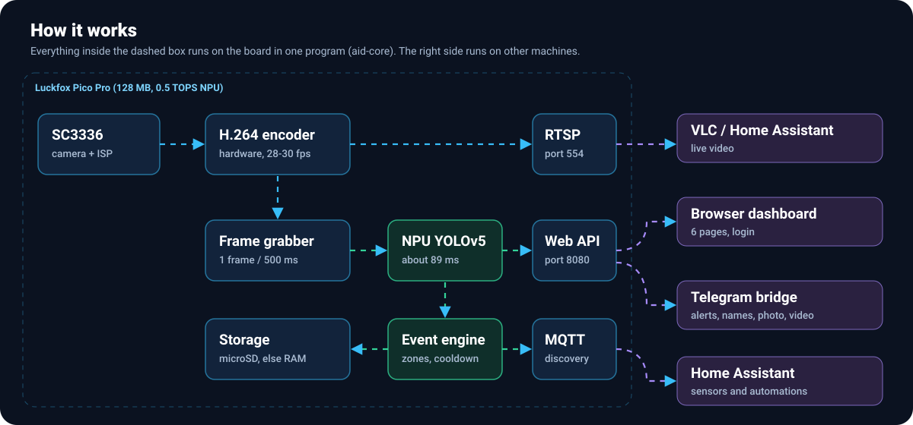

<p align="center">
  
</p>

<p align="center">
  <a href="LICENSE"></a>
  
  
  
</p>

**luckfox-ai** turns a Luckfox Pico Pro with a MIPI camera into a small network camera that runs object detection on its NPU. It has a web dashboard, events with pictures, Home Assistant (MQTT), an optional Telegram bot with photo/video and names of known people, optional microSD storage, and starts by itself at boot. It is open source (MIT).

Built and tested on **one** board (Pico Pro, SC3336 camera, Buildroot firmware 250607). The **Status** table says what was tested on the board, what only on the PC, and what is not tested yet. Please read it before you rely on anything.

## Contents
[Features](#features) · [How it works](#how-it-works) · [Quick start](#quick-start) · [Using it](#using-it) · [Home Assistant](#home-assistant) · [Telegram](#telegram-alerts-menu-and-names) · [microSD](#microsd-card) · [Configuration](#configuration) · [Status](#status) · [Known problems](#known-problems) · [Documents](#documents) · [Contributing and license](#contributing-and-license)

## Features
| | |
|---|---|
| **Camera** | SC3336 through the Rockchip ISP, 30 fps, hardware H.264, RTSP stream, JPEG snapshots, image controls |
| **AI** | YOLOv5 (80 COCO classes) on the 0.5 TOPS NPU about every 500 ms, boxes, labels, confidence, zones, counts |
| **Events** | person / vehicle / animal / motion / object entered / disappeared / camera lost / system online, each with a picture; cooldown, duplicate suppression, history, filter, CSV/JSON export |
| **Dashboard** | 6 pages (Dashboard, Live camera, AI detection, Event history, Settings, System), login with sessions, phone friendly; shows CPU, RAM, temperature, **free system flash** and **memory card space** |
| **Home Assistant** | MQTT with discovery: person / vehicle / animal / motion sensors, camera and AI status, last event, temperature, availability |
| **Telegram** | Alert with picture on detection, bot menu (photo, video, status, events, alerts on/off), optional **names of known people**; runs on your PC, not on the board |
| **microSD** | Inserted card is used automatically for a long event history and stored photos (not hardware-tested yet) |
| **GPIO** | Relays, buzzer, LED, alarm outputs; PIR and door inputs (off by default) |
| **Operation** | Starts at boot, restarts after crashes, falls back to the stock app, reboots itself from a read-only root, install / uninstall / backup / restore scripts |


*Illustration of the dashboard (not a screenshot).*

## How it works


One program (`aid-core`, about 8.7 MB of RAM) holds the camera, encoder, detector, event engine, web server and MQTT client; a tiny compiled supervisor starts it, restarts it and reboots the board if the flash fails. Details: `docs/architecture.md`.

## Quick start
You need: a Luckfox Pico Pro with an SC3336 camera, a 5 V / 3 A USB adapter (the PC's USB port is not enough, see `docs/firmware.md`), an Ethernet cable, a Windows 11 PC with WSL2 (or a Linux PC).

1. **Flash the official Luckfox Buildroot image** once (steps in `docs/firmware.md`; nothing in this project flashes the board).
2. **Prepare the PC:** WSL2 + Ubuntu 22.04 and the Luckfox SDK, SSH key login to the board (`docs/installation.md`).
3. **Test, build, install:**
   ```bash
   bash scripts/test.sh                              # PC tests, no board needed
   bash scripts/build.sh                             # cross-build
   BOARD=root@<board-ip> bash scripts/install.sh     # copies to /root/aid, adds the boot script, sets the dashboard password
   ```
4. **Open** `http://<board-ip>:8080/` (user `admin`, the password printed/stored by the installer) and VLC: `rtsp://<board-ip>:554/live/0`.
5. **Change the board's root password** and read `docs/security.md`.

Uninstall: `bash scripts/uninstall.sh`. Back up settings: `bash scripts/backup.sh`.

## Using it
`docs/user-guide.md` covers the addresses, each dashboard page, tuning the detector (classes, confidence, zones), day-to-day tasks and good practice.

## Home Assistant
Eight steps from "install the Mosquitto add-on" to "phone notification with a picture" are at the top of `docs/home-assistant.md`. In short: enable MQTT on the camera's Settings page, point it at your broker, and the **Luckfox AI Camera** device appears in Home Assistant by itself. Add the video with the Generic Camera integration (RTSP + `snapshot.jpg?token=...`). Tested on the PC with a fake broker; **not yet against a real Home Assistant**.

## Telegram alerts, menu and names


```bash
cd tools && cp telegram_bridge.conf.example telegram_bridge.conf   # token from @BotFather, your chat id, the board token
python3 telegram_bridge.py --config telegram_bridge.conf
```
You get a message with the picture when a person is seen, plus `/photo`, `/video`, `/status`, `/events`, `/alerts on|off` and a button menu. Names ("Ravi detected") are optional and run on your PC with OpenCV; you enrol people by putting photos in `known_faces/<Name>/`. Full guide, limits and privacy notes: `docs/telegram.md`. Tested with fake servers; the video path and face-model loading were run for real; **not tested against real Telegram or with real faces**.

## microSD card
`data_dir=auto` (the default) uses an inserted card for events, event pictures and stored photos (`aid-data/` on the card); without one the program uses RAM. The dashboard shows which. See `docs/sd-card.md`. **Not tested with a real card yet.**

## Configuration
Everything is in `/root/aid/aid.conf` (and on the dashboard's Settings pages). The full key reference with defaults and ranges is `docs/configuration.md`; the commented template is `config/aid.conf.example`.

| Most used | Default | |
|---|---|---|
| `width` x `height`, `fps`, `bitrate_kbps` | 1920x1080, 30, 2048 | Video |
| `detect_conf_pct`, `detect_classes`, `zone` | 45, person/car/..., whole picture | What counts as a detection |
| `event_cooldown_s` | 30 | Minimum time between events of one type |
| `http_token` | empty | Lets scripts and the Telegram bridge read the camera |
| `data_dir` | `auto` | microSD if present, else RAM |
| `mqtt_*` | off | Home Assistant |

## Status
| Area | Result | Evidence |
|---|---|---|
| Board identified (Pico Pro, RV1106G2, 128 MB, SC3336, kernel 5.10.160, RKNN runtime 1.6.0, MPP 16e796a4) | **Tested on the board** | `docs/hardware.md` |
| Camera: 30 fps at 2304x1296, 1920x1080, 1280x720; JPEG snapshot; brightness control | **Tested on the board** | `docs/camera.md` |
| RTSP stream (watched in VLC; also recorded with ffmpeg for the Telegram video path), HTTP snapshot, token protection | **Tested on the board** | `docs/streaming.md` |
| NPU detection: model loads, about 89 ms per inference, detections appear | **Tested on the board** (accuracy **not** measured) | `docs/ai-models.md` |
| Events + snapshots, motion event | Rules **tested on the PC** (101 checks); a motion event with snapshot was seen on the board; person/vehicle events not yet observed there | `tests/test_events.cc` |
| Dashboard pages | **Tested in a browser** against a demo server with fake data (login, 6 pages, phone layout, flash and card display, photo button); the API was tested on the board with curl. The real board's pages were **not** opened in a browser. | `scripts/web_demo.sh` |
| Login, sessions, lockout, CSRF, settings validation, token scope | **Tested on the PC** (161 checks) and key rules **on the board** | `docs/security.md` |
| MQTT client + Home Assistant discovery | **Tested on the PC only** (fake broker); never against a real broker/HA | `docs/home-assistant.md` |
| Telegram bridge: alerts, commands, authorisation, restarts of the board | **Tested on the PC** with fake servers (34 tests); its board side (events, pictures, `/photo`, `/status`) and the ffmpeg video path ran against the **real board**; **not against real Telegram** | `docs/telegram.md` |
| Names of known people | OpenCV models download and load; matching maths unit-tested; **not tested with real faces, accuracy unknown** | `docs/telegram.md` |
| microSD: detection, mount, storage, photos | Logic **tested on the PC**; on the board only the "no card, use RAM" fallback ran; **no card tested** | `docs/sd-card.md` |
| Free system flash on the dashboard | **Tested on the board** (`/status.json`: 130 of 181 MB free); the page itself only in the browser demo | `docs/user-guide.md` |
| Token access to events and photos, stored photos (`POST /api/capture`) | **Tested on the board** (1920x1080 JPEG stored in RAM storage, admin API still refuses the token) | `tests/test_api.cc` |
| GPIO | **Tested on the PC only** (fake sysfs); pins unverified, disabled | `src/gpio/gpio.h` |
| Autostart at boot, crash restart, 26 s cold boot to dashboard | **Tested on the board** | `docs/installation.md` |
| Supervisor reboot on read-only root | Written, **not triggered on purpose** (would need a real flash fault) | `src/core/aid_supervisor.cc` |
| `uninstall.sh`, `restore.sh`, `backup.sh --firmware` | Written, **not run** (`backup.sh` without options and `install.sh` were run) | `scripts/` |
| Video recording to a file, H.265 stream, manual exposure/gain setter | **Not implemented** | `docs/ROADMAP.md` |
| Own model conversion (RKNN-Toolkit2) | **Not done**; the Luckfox model is used | `docs/ai-models.md` |
| Stability | **1 h 56 min without a restart** on the final software (5 V / 3 A adapter): 13 551 detections, memory flat (RSS 8.66 MB, 27.4 MB free), 28 fps, temperature about 66 to 67 C, 0 flash errors. **Days are untested.** | `docs/hardware.md` section 9 |

Tests: `bash scripts/test.sh` runs 584 C++ checks and 34 Python tests on the PC.

## Known problems
- **The board's SPI flash controller timed out four times** during development (files unreadable, root filesystem read-only) until a restart. Cause not proven; possibly power, possibly the flash itself. The software avoids flash access while running and the supervisor reboots by itself if it happens. See `docs/streaming.md` and `docs/firmware.md`.
- No encryption (HTTP, MQTT) and no RTSP password; telnet/adb of the stock firmware are still on. See `docs/security.md`.
- Event history is kept in RAM (lost at reboot) unless a microSD card is used.
- Detection quality is unverified; the model is a small INT8 YOLOv5. The board clock is wrong until it reaches an NTP server, so the first events after a boot can carry a wrong time.
- Names of known people need clear, close, front-facing faces and are not suitable for security decisions.

## Documents
| | |
|---|---|
| Use | `docs/user-guide.md` · `docs/home-assistant.md` · `docs/telegram.md` · `docs/sd-card.md` · `docs/configuration.md` |
| Install | `docs/installation.md` · `docs/firmware.md` · `docs/security.md` |
| Inside | `docs/architecture.md` · `docs/camera.md` · `docs/streaming.md` · `docs/ai-models.md` · `docs/hardware.md` (measured facts) |
| Future | `docs/ROADMAP.md` |

## Contributing and license
Contributions and test reports from other boards are welcome: see `CONTRIBUTING.md`.

Licensed under the **MIT License** (`LICENSE`), Copyright (c) 2026 ElectroIoT. `src/ai/third_party/rockchip/` is Rockchip code under the Apache License 2.0 (see its `NOTICE.md`). The YOLOv5 model and the Rockchip libraries come from the Luckfox SDK and example repositories and are **not** stored here and keep their own licenses; the optional face models (YuNet, MIT; SFace, Apache-2.0) are downloaded by the user from the OpenCV Zoo.

Not affiliated with Luckfox, Rockchip, Home Assistant or Telegram; all names belong to their owners.
